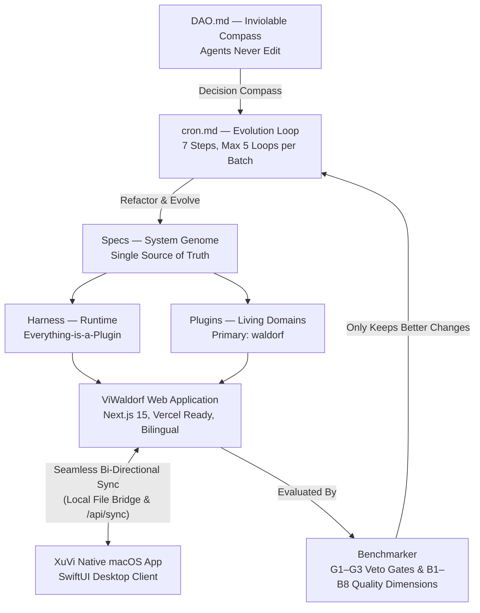

# ViWaldorf Harness — Self-Evolving Agentic Platform with DAO Compass

> **One-Sentence Purpose:** A self-evolving agentic platform rooted in the living ethos of Waldorf-inspired education applied to Vietnam's rich cultural diversity — delivering a modern, responsive web application deployable to Vercel, seamlessly synchronized with its native macOS sibling (`xuvi-harness`), and guided by an inviolable ethical compass ([DAO.md](DAO.md)).

---

## 1. System Map



| Component | Metaphor | Role | Location |
|---|---|---|---|
| **DAO** | Constitution / Compass | Answers *"What is worth doing, and what must never be traded away"* | [DAO.md](DAO.md) |
| **Specs** | Genome / Long-Term Memory | Defines *what the system must be*; real evolution happens here | `*/specs/**` |
| **Harness** | Nervous System | Pluggable runtime where capabilities and tools are isolated | [harness/specs/](harness/specs/README.md) |
| **Waldorf Plugin** | Living Domain | Storytelling practice, 3 Waldorf painting styles, dialect learning, 6 curriculum documents | [plugins/waldorf/specs/](plugins/waldorf/specs/00_master_prompt.md) |
| **Web App** | Accessible Living Body | Responsive Next.js 15 app on Vercel with bilingual (EN/VI) support | `app/`, `components/`, `lib/` |
| **macOS Native** | Desktop Twin | High-performance SwiftUI native client in `xuvi-harness` | `xuvi-harness/app` |
| **Benchmarker** | Conscience & Evidence | Evaluates veto gates (`G1–G3`) and quality dimensions (`B1–B8`) | [benchmarker/specs/](benchmarker/specs/README.md) |
| **Evolution Loop** | Heartbeat | 7-step autonomous cycle for refactoring, testing, and verifying | [cron.md](cron.md) |

---

## 2. Core Principles of Minimalism

1. **Prefer minimizing requirements over adding new ones.**
2. **Prefer refactoring existing systems over writing new code.**
3. **Prefer deleting text and boilerplate over adding text.**
4. **Zero-Warning Strict Quality**: No unhandled errors, clean TypeScript build.
5. **Only commit specifications, source code, and benchmark results**: Never commit environment variables, secret keys, or real student personal data.

---

## 3. Key Capabilities & The 6 Views

The application provides exact visual and workflow parity with the native macOS version:

1. **Dashboard (Today's Garden)**:
   - Overview of active stories, practice metrics, dialect rules, and seasonal curriculum rhythms.
2. **Story Retelling Practice**:
   - Story selection and upload (.txt / .md / manual input) with automated scene decomposition.
   - **Step 1 — Scene Map & 3 Waldorf Art Techniques**: Wet-on-Wet watercolor (Goethean color theory washes), Crayon drawing (beeswax crayons), and Chalkboard pastel drawing. Includes procedural canvas rendering and AI generation prompts.
   - **Step 2 — Voice Recording & Acoustic Analysis**: Direct in-browser 24kHz WAV audio recording with immediate acoustic delivery metrics (duration, RMS loudness dB, dynamic range, pause ratio %, and pace in WPM).
   - **Step 3 — Transcription & Dialect Adaptation**: Privacy-first transcription with explicit consent toggles. Local dialect rule engine preserving regional pronunciations (Quảng Nam, Central, Northern, Southern).
   - **Constructive Heuristic Feedback**: Warm, encouragement-oriented feedback without punitive numerical scores.
3. **Weekly Schedule (Timetable)**:
   - Monday–Friday 08:00–15:00 interactive grid distinguishing Main Lesson / Instructional time from Living Rhythm.
   - Live schedule validation (overlap detection, time gap checks, 2,100 minutes weekly total).
4. **Classroom Documents & Portfolio**:
   - Live generation of all 6 mandatory educational documents: Overall Program, Grade Program, Alignment Matrix, Academic Year Plan, Timetable, and Teaching Journal.
   - Markdown copy and `.md` file download.
   - Teaching Journal observation entry form (student-centered, non-judgmental).
5. **AI Assistant Chat**:
   - Pedagogical dialogue with prompt suggestions and tool execution.
6. **Settings & Sync Center**:
   - Key management (`META_API_KEY`), complete JSON backup export and restore, seed data reset, and cross-device sync pairing.

---

## 4. Seamless Synchronization Architecture

ViWaldorf provides dual-mode synchronization between this web app and the macOS desktop app (`xuvi-harness`):

1. **Local Mode (Direct File System Access API)**:
   When running the web app on your Mac, connect directly to `~/Library/Application Support/XuViHarness/waldorf.json`. The web app reads and writes directly to disk with atomic backups—zero latency, zero cloud storage, 100% private.
2. **Remote Vercel Mode (Encrypted `/api/sync`)**:
   When deployed on Vercel, the app provides a serverless `/api/sync` endpoint. Data is encrypted client-side using your personal Passkey (AES-GCM) before transmission, ensuring zero-knowledge privacy across multiple devices.

---

## 5. Development & Deployment

### Local Development
```bash
# Install dependencies
pnpm install # or npm install

# Run development server
pnpm dev # or npm run dev
# Open http://localhost:3000
```

### Build & Typecheck
```bash
pnpm build
```

### Deploy to Vercel
```bash
# Deploy via Vercel CLI or connect repository on Vercel Dashboard
vercel
```
