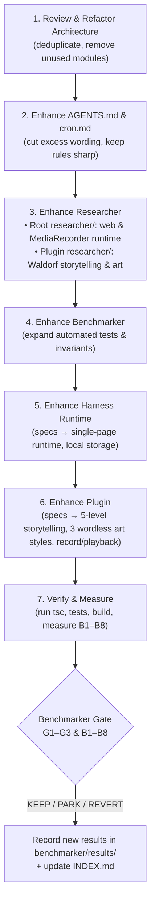

# cron.md — The Self-Evolution Rhythm of ViWaldorf Harness

> This document defines the **evolution loop** of `ViWaldorf-harness` and stands directly under [DAO.md](DAO.md).
> Read first: [README.md](README.md), [AGENTS.md](AGENTS.md), and [benchmarker/specs/01-overall-benchmark.md](benchmarker/specs/01-overall-benchmark.md).

---

## 1. Essence of a Loop

**One Loop = One Verifiable and Reversible Evolutionary Hypothesis.**

Each loop strictly adheres to 3 minimalist priorities:
1. **Minimize requirements rather than adding new ones.**
2. **Refactor existing code rather than writing new code.**
3. **Delete redundant text rather than adding text.**

A single batch is budgeted for a maximum of **5 loops** (or stops earlier when meeting completion or abort conditions in Section 4).

---

## 2. The 7 Steps of Each Loop

---

## 3. The Three Decision Gates

### Gate 1 — DAO (Absolute Veto)
Immediately reject any change that:
- Compromises the freedom, safety, or natural developmental pace of children, parents, or teachers;
- Introduces external data leakage or AI tracking of voice recordings;
- Falsifies evidence (claiming unverified state accreditations or mislabeling local graphics);
- Weakens learnability (code changes untraceable to specs).

### Gate 2 — Benchmarker
- **KEEP**: All automated checks pass, all 3 veto gates `G1–G3` are `PASS` with evidence, at least one dimension `B1–B8` improves (or complexity/code decreases with improved focus), and no dimension degrades.
- **REVERT**: Any technical check fails or any veto gate `G1–G3` is `FAIL`.
- **PARK**: Any gate is `UNMEASURED` — defaults to `PARK`.

### Gate 3 — Whitelist Commit
Before concluding each loop, verify `git status`:
- Only whitelisted files may be modified.
- Any unauthorized modification to `DAO.md` triggers an **immediate, unconditional rollback**.

---

## 4. Stopping Conditions (Max 5 Loops per Batch)

1. Completion of 5 evolution loops with all tests and veto gates passing.
2. Two consecutive loops resulting in `REVERT` or `PARK`.
3. Any breach of DAO boundaries (stops immediately to correct specs first).
