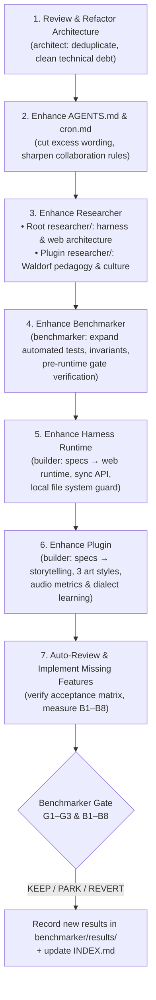

# cron.md — The Self-Evolution Rhythm of ViWaldorf Harness

> This document defines the **autonomous evolution loop** of `ViWaldorf-harness` and stands directly under [DAO.md](DAO.md).
> Read first: [README.md](README.md), [AGENTS.md](AGENTS.md), and [benchmarker/specs/01-overall-benchmark.md](benchmarker/specs/01-overall-benchmark.md).

---

## 1. Essence of a Loop

**One Loop = One Verifiable and Reversible Evolutionary Hypothesis.**

Each loop strictly adheres to 3 minimalist priorities:
1. **Minimize requirements rather than adding new ones.**
2. **Refactor existing code rather than writing new code.**
3. **Delete redundant text rather than adding text.**

A single automated batch is budgeted for a maximum of **5 loops** (or stops earlier when meeting completion or abort conditions in Section 4).

---

## 2. The 7 Steps of Each Loop

| Step | Lead Role | Mandatory Deliverable |
|---|---|---|
| **1. Review & Refactor Architecture** | `architect` (`Gemini` + `muse-wonder-1.0`) | Identify bottlenecks/duplicates, unify modules, delete dead code. |
| **2. Enhance `AGENTS.md` & `cron.md`** | `orchestrator` | Condense instructions, sharpen multi-model division of labor and hard boundaries. |
| **3. Enhance `researcher`** | `researcher` (Root) & `plugin-researcher` | Update `researcher/specs/` or `plugins/<name>/researcher/specs/` with clear `adopt / watch / reject` verdicts. |
| **4. Enhance `benchmarker`** | `benchmarker` | Add automated regression checks, runtime invariants, and test contracts. |
| **5. Enhance `harness`** | `builder` | Update `harness/specs/` and refactor web runtime, sync endpoints, and guards. |
| **6. Enhance `plugin`** | `builder` + `capabilities` | Update `plugins/<name>/specs/` and enhance Waldorf storytelling, art, and documents. |
| **7. Auto-Review, Implement & Measure** | `benchmarker` + `orchestrator` | Run all automated tests, perform live checks, record report in `benchmarker/results/` and update `INDEX.md`. |

---

## 3. The Three Decision Gates (Autonomous AI Decision)

### Gate 1 — DAO (Absolute Veto)
Immediately reject any change that:
- Compromises the freedom, safety, or natural developmental pace of children, parents, or teachers;
- Trades away privacy (exposing API keys, `.env`, real student personal data, transmitting data without consent);
- Falsifies evidence (labeling local heuristics as AI, fabricating references, claiming unverified state accreditations);
- Weakens learnability (code changes untraceable to specs).

### Gate 2 — Benchmarker (`EvolutionGateJudge`)
- **KEEP**: All automated checks pass, all 3 veto gates `G1–G3` are `PASS` with evidence, at least one dimension `B1–B8` improves (or complexity/code decreases with 100% feature preservation), and no dimension degrades.
- **REVERT**: Any technical check fails or any veto gate `G1–G3` is `FAIL`.
- **PARK**: Any gate is `UNMEASURED` — automatically rejects a `KEEP` verdict and defaults to `PARK`.

### Gate 3 — Whitelist Commit
Before concluding each loop, verify `git status`:
- Only whitelisted files may be committed.
- Any unauthorized modification to `DAO.md` triggers an **immediate, unconditional rollback of the entire loop**.

---

## 4. Stopping Conditions (Max 5 Loops per Batch)

1. Completion of 5 evolution loops with all tests and veto gates passing.
2. Two consecutive loops resulting in `REVERT` or `PARK`.
3. Any breach of DAO boundaries (stops immediately to correct specs first).
