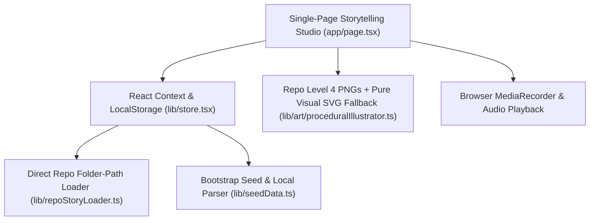

# 01 — Architecture Overview

> Governed by [DAO.md](../../DAO.md) and [AGENTS.md](../../AGENTS.md).

## 1. System Philosophy

ViWaldorf Harness is designed around three strict architectural principles:
1. **100% Local-First Execution & Zero AI**: All interactive features—5-level storytelling practice, age-variant switching (`3-5`, `6-10`, `11+`), local story segmentation, pure visual fallback SVG art (`ProceduralIllustrator`), and voice recording/playback (`MediaRecorder`)—execute completely inside the user's browser with zero AI models or APIs.
2. **Direct Folder-Path Content Sync**: The default story (*Từ Sáng Thế Đến Giáng Sinh*, 5 books, 28 scenes) is loaded directly from `https://github.com/xuvivn/from-genesis-to-nativity` via `story-index.json` and its level folder paths (`level-0-khong-gian-boi-canh/` through `level-4-tranh-goi-nho/`), with local seed fallback for instant/offline readiness.
3. **Single-Focus Experience & Sacred Privacy**: The web application opens directly into the Storytelling Practice Studio (`/`) with no secondary modules. Voice recordings exist only as in-browser `Blob` object URLs (`<audio controls>`) and are never transmitted to any server.

## 2. Component Diagram

## 3. Data Flow Guarantees

- **Zero AI & Zero Backend Endpoints**: No `/api/*` endpoints, no AI gateways, and no external telemetry. Only public read-only GET requests are issued to `raw.githubusercontent.com/xuvivn/from-genesis-to-nativity/main/...` to load updated story files by folder path.
- **No Automated Evaluation**: Audio recording is purely for recording and listening back to one's own voice.
