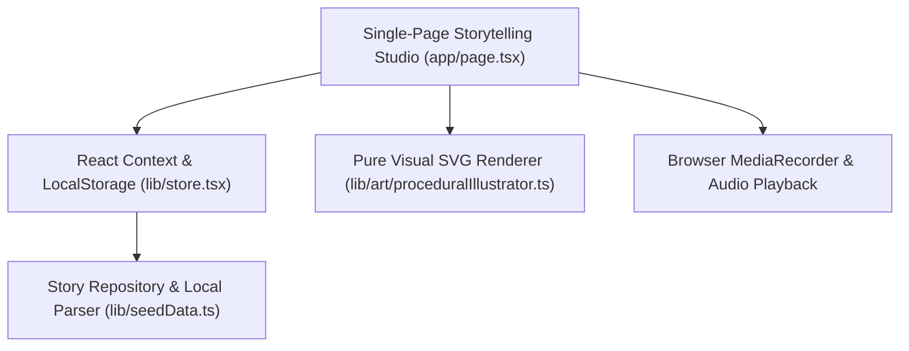

# 01 — Architecture Overview

> Governed by [DAO.md](../../DAO.md) and [AGENTS.md](../../AGENTS.md).

## 1. System Philosophy

ViWaldorf Harness is designed around three strict architectural principles:
1. **100% Local-First & Zero AI**: All features—5-level storytelling practice, local story segmentation, pure visual SVG art (`ProceduralIllustrator`), and voice recording/playback (`MediaRecorder`)—execute completely inside the user's browser with zero external APIs or AI models.
2. **Single-Focus Experience**: The web application opens directly into the Storytelling Practice Studio (`/`) with no secondary modules or dashboards.
3. **Sacred Privacy**: Voice recordings exist only as in-browser `Blob` object URLs (`<audio controls>`) and are never transmitted to any server.

## 2. Component Diagram

## 3. Data Flow Guarantees

- **Zero Network Calls**: No `/api/*` endpoints, no AI gateways, and no external telemetry.
- **No Automated Evaluation**: Audio recording is purely for recording and listening back to one's own voice.
