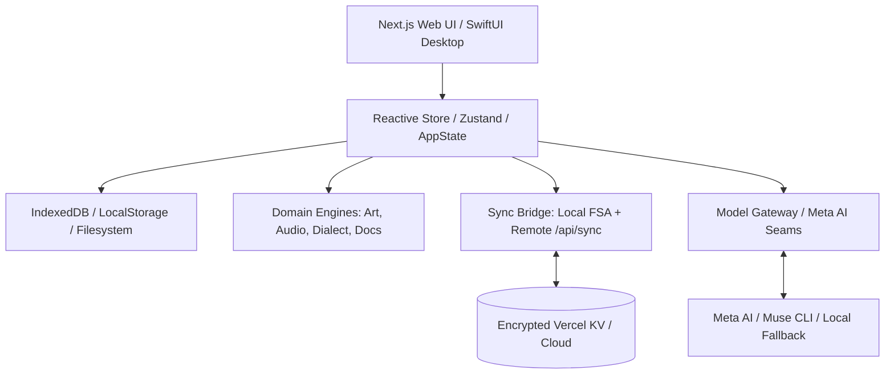

# 01 — Architecture Overview

> Governed by [DAO.md](../../DAO.md) and [AGENTS.md](../../AGENTS.md).

## 1. System Philosophy

ViWaldorf Harness is designed with three architectural imperatives:
1. **Local-First & Offline Resilience**: Core functionality (story reading, scene breakdown, 3 art styles, audio recording, acoustic analysis, timetable validation, document preview) must run completely client-side in the browser without requiring network calls or cloud backends.
2. **Decoupled Twin Topology**: The ecosystem supports two harmonious frontends sharing the exact same canonical JSON data format (`waldorf.json`):
   - **Desktop Twin (`xuvi-harness`)**: Native macOS SwiftUI app running with local system access.
   - **Web Twin (`ViWaldorf-harness`)**: Next.js 15 application deployable to Vercel, accessible on any modern device.
3. **Pluggable Architecture**: Everything is isolated as a capability plugin. The primary pedagogical plugin is `waldorf`.

## 2. Component Diagram

## 3. Data Flow Guarantees

- **No Silent Network Calls**: Audio recording and metrics calculation execute entirely within the Web Audio API sandbox.
- **Privacy Gate**: Remote AI services require explicit user toggle activation.
- **Atomic State Integrity**: Every mutation to data is validated against the schema before saving.
