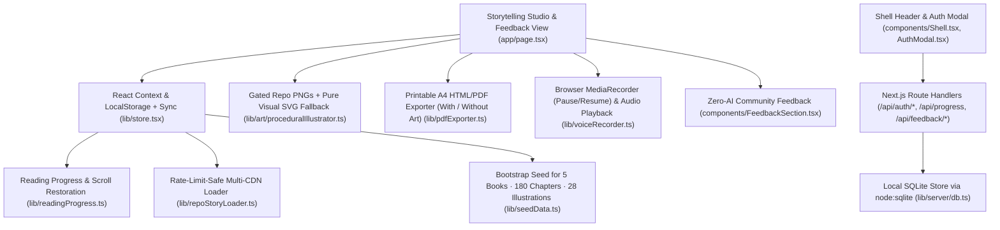

# 01 — Architecture Overview

> Governed by [DAO.md](../../DAO.md) and [AGENTS.md](../../AGENTS.md).

## 1. System Philosophy

ViWaldorf Harness is designed around three strict architectural principles:
1. **100% Zero-AI Storytelling & Privacy-Respecting Sync**: All storytelling features—4-level storytelling practice (Levels 1–4), optional Background & Story Soul reading drawer (`locales/{lang}/level-0-context/`) with a dedicated edge-to-edge ancient-text reader and text-specific local recorder context, full-text PDF export with two modes (with embedded Level 4 illustrations or text-only without images via `lib/pdfExporter.ts`, mounting an isolated `@media print` root `#viwaldorf-print-root` on `document.body` with `hasFullStoryPassages` verification so mobile and desktop browsers reliably print the full 180-chapter document), pure visual fallback SVG art (`ProceduralIllustrator`), and voice recording/playback (`MediaRecorder` with seamless Pause/Resume in a single take via `lib/voiceRecorder.ts`)—execute completely inside the user's browser with zero AI models or APIs. Voice recordings exist only as in-browser `Blob` object URLs (`<audio controls>`) and are never transmitted to any server.
2. **Rate-Limit-Safe Two-Epic Multilingual Repo Content Sync**: The application serves **Đẻ Đất Đẻ Nước** / *The Birth of Earth and Water* / *天地水生* (default on first visit: 6 Hồi, 28 Chương, 28 tranh across `vi`, `en`, `zh`, with `image_generated: false` rendering nothing in Level 4 until generated or user-uploaded) and **Từ Sáng Thế Đến Giáng Sinh** / *From Genesis to Nativity* / *从创世到圣诞* (5 books, 180 chapters, 28 cluster illustrations across `vi`, `en`, `zh`). Data is loaded from `xuvivn/de-dat-de-nuoc` and `xuvivn/from-genesis-to-nativity` through `languages.json`, `locales/{lang}/story-index.json`, Level 0–3 Markdown, and shared image assets via `/api/local-repo?repo=earth|genesis` on localhost, jsDelivr CDN, and GitHub Raw fallback. Bounded concurrency (max 6), 6-hour per-`(storyId, lang)` cache TTL, 15-second manual sync cooldown, and `imageGenerated` gating remain mandatory.
3. **Reading Progress Restoration, Member Sign-In & Human Community Feedback**:
   - **Browser Progress Persistence**: The active book, practice level, chapter (`sceneId` + `sceneIndex`), illustration (`illustrationId` + `illustrationIndex`), reading display settings (`level1FlowMode`, `level1TextSize`, `level3Scope`, `showContextSection`), and scroll position (`scrollY` + `scrollRatio`) are saved in `localStorage` (`viwaldorf_reading_progress_v1`) and restored automatically when reopening the site in the same browser.
   - **Member Sign-In & Google SSO**: Optional Email/Password registration & sign-in plus Google OAuth 2.0 SSO (`/api/auth/*`) allow members to synchronize their reading progress across sessions via `/api/progress` and prepare for future member features.
   - **Zero-AI Community Feedback**: Public feedback threads (`/api/feedback/*`) enable parents and educators to share bug reports, content suggestions, and feature ideas without any AI branding, AI labels, or automated grading; official replies are authored by *Ban biên tập ViWaldorf*.

## 2. Component Diagram

## 3. Data Flow Guarantees

- **Zero AI**: Zero AI endpoints, zero AI API keys, and zero AI terminology in community feedback or storytelling flows.
- **Audio Sovereignty**: Voice recordings stay strictly in-browser (`Blob` URLs); never uploaded.
- **SEO & Share Metadata**: `app/layout.tsx` (constants in `lib/site.ts`) emits title, description, canonical, Open Graph (`vi_VN`), `twitter:card=summary_large_image`, and JSON-LD (`WebSite` + `CreativeWork`, ages 9–10, free; no certification claims). Share image `app/opengraph-image.jpg` (+ `twitter-image.jpg`) is a 1200×630 crop of repo Illustration 08 (Noah's ark & rainbow); `app/icon.svg` is a local procedural rainbow icon. `app/robots.ts` allows `/`, disallows `/api/`; `app/sitemap.ts` lists `/`, `/truyen/{story-slug}`, `/truyen/{story-slug}/{book-slug}`, and `/truyen/{story-slug}/chuong-{so}-{chapter-slug}`. `app/truyen/[storySlug]/page.tsx` and unified `app/truyen/[storySlug]/[segment]/page.tsx` prerender all story, book, and chapter routes with HTTP 200 canonical metadata using language-independent `vi` seed slugs (`lib/seoRoutes.ts`), while `app/page.tsx` synchronizes the browser address bar offline via the History API (`replaceState` / `pushState` + `popstate`) without unmounting the page or interrupting in-browser `MediaRecorder` takes.
- **Session & OAuth Security**: Password hashing uses `crypto.scryptSync` with `crypto.timingSafeEqual`; sessions use `HttpOnly`, `SameSite=Lax` cookies; Google OAuth uses Authorization Code flow with CSRF `state` verification and verified email validation.
