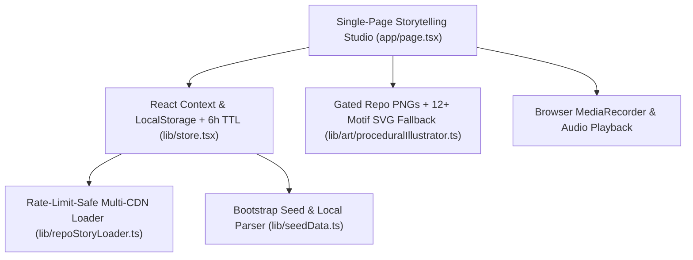

# 01 — Architecture Overview

> Governed by [DAO.md](../../DAO.md) and [AGENTS.md](../../AGENTS.md).

## 1. System Philosophy

ViWaldorf Harness is designed around three strict architectural principles:
1. **100% Local-First Execution & Zero AI**: All interactive features—5-level storytelling practice, age-variant switching (`3-5`, `6-10`, `11+`), local story segmentation, pure visual fallback SVG art (`ProceduralIllustrator`), and voice recording/playback (`MediaRecorder`)—execute completely inside the user's browser with zero AI models or APIs.
2. **Rate-Limit-Safe Repo Content Sync**: The default story (*Từ Sáng Thế Đến Giáng Sinh*, 5 books, 28 scenes) is loaded from `xuvivn/from-genesis-to-nativity` (`story-index.json` and `level-0-*` .. `level-4-*`) via jsDelivr CDN (`cdn.jsdelivr.net`) with `raw.githubusercontent.com` fallback, bounded concurrency (max 6 parallel requests), a 6-hour `localStorage` sync TTL (0 network requests on repeat visits inside TTL), a 15-second manual sync cooldown, and `imageGenerated` gating to prevent 404 image requests.
3. **Single-Focus Experience & Sacred Privacy**: The web application opens directly into the Storytelling Practice Studio (`/`) with no secondary modules. Voice recordings exist only as in-browser `Blob` object URLs (`<audio controls>`) and are never transmitted to any server.

## 2. Component Diagram

## 3. Data Flow Guarantees

- **Zero AI & Zero Backend Endpoints**: No `/api/*` endpoints, no AI gateways, and no external telemetry. Only public read-only GET requests are issued to `cdn.jsdelivr.net` (with `raw.githubusercontent.com` fallback) when the 6-hour cache TTL expires or on user-triggered sync (15s cooldown). Never calls `api.github.com` or scrapes `github.com` HTML.
- **No Automated Evaluation**: Audio recording is purely for recording and listening back to one's own voice.
