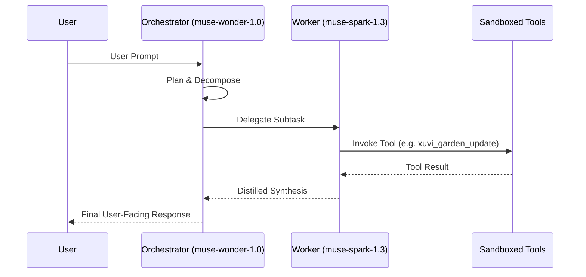

# 03 — Agent Loop and Tool Execution

> Governed by [DAO.md](../../DAO.md).

## 1. Agent Loop Concept

The agent loop executes multi-step tasks by cycling through reasoning, tool invocation, result distillation, and final response generation.

## 2. Invariants

1. **Context Distillation**: Workers execute subtasks in separate conversation contexts and deliver only distilled summaries to the parent context to keep context windows clean.
2. **Audit Logging**: Every tool call and response is recorded in transparent session logs.
3. **Fail-Closed Security**: Any tool operation violating workspace boundaries is immediately rejected.
